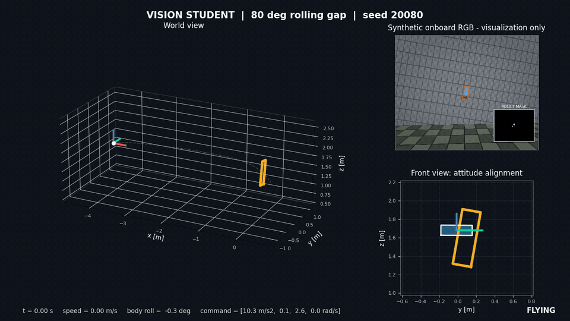
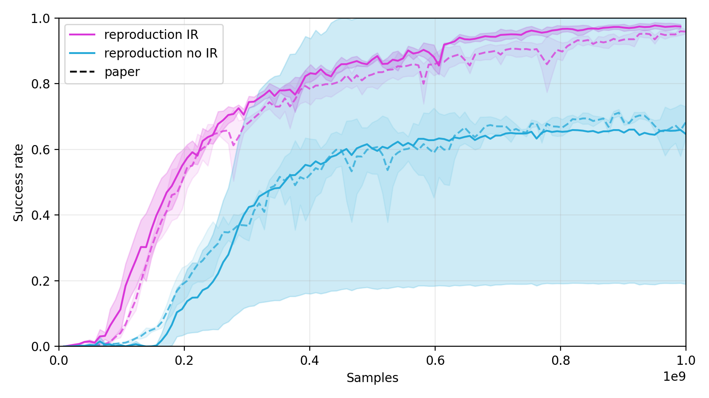

<h1 align="center">Sensorimotor Narrow-Gap Reproduction</h1>

<p align="center">
  <strong>An independent, GPU-vectorized reproduction of aggressive quadrotor flight through rolling narrow gaps.</strong>
</p>

<p align="center">
  <a href="#results-at-a-glance">Results</a> ·
  <a href="#installation">Installation</a> ·
  <a href="#quick-start">Quick Start</a> ·
  <a href="#full-training">Full Training</a> ·
  <a href="RESULTS.md">中文结果报告</a> ·
  <a href="REPRODUCTION.md">Protocol</a>
</p>

<p align="center">
  
</p>

This repository independently reproduces the central **simulation** experiments from
[*Precise Aggressive Aerial Maneuvers with Sensorimotor Policies*](https://arxiv.org/abs/2604.05828)
(Wu et al., 2026): a privileged PPO teacher, the informed-reset ablation from Fig. 7A, and a
recurrent image student distilled with on-policy DAgger.

> [!IMPORTANT]
> This is not the authors' private simulator or official implementation. At the time of this
> reproduction, the simulator, checkpoints, informed-reset states, segmentation dataset and
> deployment code were not public. Every replacement assumption is documented in
> [`REPRODUCTION.md`](REPRODUCTION.md).

## Results at a Glance

### Fig. 7A teacher training

Three seeds are evaluated every 8.192M samples with 4096 deterministic episodes per evaluation.

| Condition | Reproduction | Paper reference | Evaluation point |
|---|---:|---:|---:|
| Informed reset | **97.46%** | 96.00% | 991.232M samples |
| No informed reset | **64.75%** | 68.23% | 999.424M samples |

<p align="center">
  
</p>

The released stable teacher reaches **98.3%** deterministic success on 8192 standard-start
episodes with gap roll sampled uniformly from 0° to 90°. The no-IR mean is close to the paper, but
its seed variance is much larger; the full variance and peak-regression analysis is reported in
[`RESULTS.md`](RESULTS.md).

### Vision student

| Static gap roll | Reproduction | Paper unified | Paper separate |
|---:|---:|---:|---:|
| 30° | **99.4%** | 100.0% | 100.0% |
| 60° | **98.4%** | 95.7% | 97.5% |
| 80° | **86.9%** | 88.6% | 92.3% |

The selected student was supervised by the earlier 201M teacher. Distilling the final stable 1B
teacher did not recover the table-level student result, so this repository does **not** claim a
single final-teacher-to-final-student training chain.

## Qualitative Rollouts

- [Privileged teacher: 80° rolling gap](artifacts/qualitative/teacher_roll80_rgb_success.mp4)
- [Vision student: 80° rolling gap](artifacts/qualitative/student_roll80_rgb_success.mp4)

Each video shows the world trajectory, attitude alignment, a synchronized synthetic RGB camera and
the binary landmark mask. The RGB scene is visualization-only. The student consumes the
`320 × 256` binary mask plus proprioception; the teacher consumes privileged gap points and state.

## What Is Implemented

- GPU-vectorized 60 Hz quadrotor dynamics with collective-thrust/body-rate control.
- Exact cuboid-versus-gap `SE(3)` collision tests for a `20 cm × 60 cm` opening.
- Delay and command averaging, response/drag randomization, perturbation forces and informed reset.
- Separate PPO actor and critic with the paper's point-cloud teacher architecture.
- Binary landmark projection and the paper's CNN-GRU image student.
- On-policy recurrent DAgger with episode-boundary hidden-state resets.
- Fixed-angle evaluation, three-seed Fig. 7A aggregation and synchronized rollout rendering.

The implemented scope is a **single static rectangular rolling gap**. Real hardware, learned RGB
segmentation, moving or consecutive gaps, pitched gaps and alternate geometries remain outside the
reproduction claim.

## Installation

### Requirements

- Linux and Python 3.10 or newer.
- PyTorch 2.4 or newer.
- An NVIDIA GPU is strongly recommended; full-scale training is designed for CUDA.
- `ffmpeg` or the bundled `imageio-ffmpeg` binary for MP4 rendering.

Create an isolated environment and install the package:

```bash
python3 -m venv .venv
source .venv/bin/activate
python -m pip install --upgrade pip setuptools wheel

# For CUDA, install the PyTorch build matching your driver first.
python -m pip install torch
python -m pip install -e '.[dev]'
```

The core simulator does not require Flightmare, Unity, ROS or PX4.

### Offline installation

On a networked machine with the same OS, Python and CUDA compatibility, download the wheels:

```bash
mkdir -p wheelhouse
python -m pip download --dest wheelhouse -r requirements.txt
python -m pip download --dest wheelhouse pytest setuptools wheel
```

Download the appropriate CUDA-enabled PyTorch wheel separately if the default index does not
provide the required build, copy `wheelhouse/` to the offline machine, then run:

```bash
python3 -m venv .venv
source .venv/bin/activate
python -m pip install --no-index --find-links wheelhouse setuptools wheel
python -m pip install --no-index --find-links wheelhouse --no-build-isolation -e '.[dev]'
```

## Quick Start

### 1. Verify the installation

```bash
python -m pytest -q
```

The current test suite contains 16 tests covering geometry, quaternion integration, action mapping,
reward interpretation, informed trajectories, recurrent resets and both image renderers.

### 2. Evaluate the released checkpoints

```bash
# Stable 1B privileged teacher: random 0-90 degree gaps.
python -m sensorimotor.evaluate_teacher \
  artifacts/teachers/reproduced_teacher_stable_1b.pt \
  --random-angles --episodes 8192 --device cuda:0

# Released recurrent image student: paper-reported static angles.
python -m sensorimotor.evaluate_student \
  artifacts/students/reproduced_student.pt \
  --angles 30 60 80 --episodes 4096 --device cuda:0
```

Use `--device cpu` for a slower CPU-only evaluation.

### 3. Render successful rollouts

The renderer searches standard-start seeds until it finds a successful episode and writes an H.264
video plus a four-frame PNG montage:

```bash
python scripts/render_policy_rollout.py teacher \
  artifacts/teachers/reproduced_teacher_stable_1b.pt \
  --angle 80 --output artifacts/qualitative/teacher_roll80_rgb_success.mp4

python scripts/render_policy_rollout.py student \
  artifacts/students/reproduced_student.pt \
  --angle 80 --output artifacts/qualitative/student_roll80_rgb_success.mp4
```

## Full Training

Full paper-scale runs are expensive: the teacher uses 2048 parallel environments and a one-billion
sample budget. Start with a smoke test before launching a long run:

```bash
python -m sensorimotor.train_teacher --config configs/single_gap_roll.yaml --smoke
python -m sensorimotor.train_student --config configs/distill_single_gap_roll.yaml --smoke
```

### Stable informed-reset teacher

The validated schedule lowers the actor learning rate and freezes observation normalization after
604.5696M samples to avoid late-stage regression:

```bash
python -m sensorimotor.train_teacher \
  --config configs/single_gap_roll.yaml \
  --total-samples 604569600 \
  --run-dir runs/single_gap_roll_ir_base

python -m sensorimotor.train_teacher \
  --config configs/single_gap_roll.yaml \
  --resume runs/single_gap_roll_ir_base/checkpoints/teacher_final.pt \
  --total-samples 1000000000 \
  --actor-learning-rate 1e-4 \
  --normalizer-freeze-samples 0 \
  --run-dir runs/single_gap_roll_ir_stable
```

### No-IR ablation and three-seed Fig. 7A

```bash
python -m sensorimotor.train_teacher --config configs/single_gap_roll_no_ir.yaml

# Launches three IR and three no-IR runs on CUDA devices 0-5, then plots the result.
bash scripts/run_fig7a_multigpu.sh
```

### Vision student

The released student uses two DAgger stages: all angles first, followed by low-rate high-angle
stabilization.

```bash
python -m sensorimotor.train_student \
  --config configs/distill_single_gap_roll.yaml \
  --updates 300 \
  --run-dir runs/distill_reproduced_teacher_201m

python -m sensorimotor.train_student \
  --config configs/distill_single_gap_roll.yaml \
  --resume runs/distill_reproduced_teacher_201m/checkpoints/student_300.pt \
  --updates 1000 \
  --learning-rate 1e-5 \
  --gap-roll-range 60 90 \
  --run-dir runs/distill_high_angle_finetune_lr1e5
```

### Regenerate the informed-reset trajectory

```bash
python scripts/generate_ir_trajectory_library.py \
  --output artifacts/ir/optimized_single_gap_roll.pt
```

## Repository Layout

```text
sensorimotor/        simulator, geometry, models, PPO, DAgger and evaluation
configs/             faithful teacher/no-IR/student experiment configurations
scripts/             trajectory tools, plotting, multi-GPU launch and video rendering
artifacts/           curated release checkpoints, figures and qualitative videos
reference_data/      extracted public Fig. 7A reference curve
tests/               focused simulator and model regression tests
RESULTS.md           detailed Chinese results, negative results and limitations
REPRODUCTION.md      protocol, assumptions and fidelity decisions
```

Large experiment directories, intermediate checkpoints, the paper PDF, raw Zenodo files and local
third-party source trees are intentionally excluded from Git. They are not required to evaluate the
released models.

## Public Sources and Acknowledgements

- Paper: [arXiv:2604.05828](https://arxiv.org/abs/2604.05828)
- Author deposit: [Zenodo 10.5281/zenodo.18005929](https://doi.org/10.5281/zenodo.18005929)
- Dynamics and planning references: [Flightmare](https://github.com/uzh-rpg/flightmare),
  [GCOPTER](https://github.com/ZJU-FAST-Lab/GCOPTER),
  [RapidQuadrocopterTrajectories](https://github.com/markwmuller/RapidQuadrocopterTrajectories) and
  [PX4-Autopilot](https://github.com/PX4/PX4-Autopilot).

If this reproduction is useful, cite the original work:

```bibtex
@article{wu2026precise,
  title   = {Precise Aggressive Aerial Maneuvers with Sensorimotor Policies},
  author  = {Wu, Tianyue and Xu, Guangtong and Wang, Zihan and Lin, Junxiao and
             Chen, Tianyang and Wu, Yuze and Han, Zhichao and Liu, Zhiyang and Gao, Fei},
  journal = {arXiv preprint arXiv:2604.05828},
  year    = {2026}
}
```

This repository is an independent scientific reproduction and is not affiliated with or endorsed
by the paper authors.
